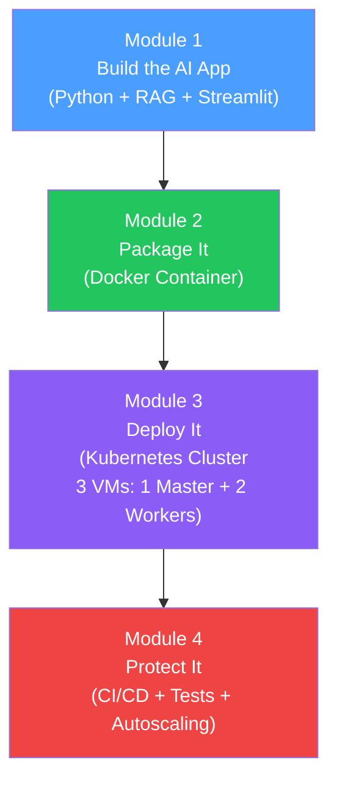

# Module 4: Production Ops — CI/CD, Testing & Scaling

Welcome to Module 4! Your AIOps assistant is now running on a Kubernetes cluster (Module 3). But here's the problem: **how do you safely ship new changes to it?**

In Module 3, you deployed the app manually by running `kubectl apply` commands. That works in a lab, but in production, one typo or one forgotten step can bring the entire system down. This module teaches you how to **automate** everything — so that code changes flow from your laptop to production safely, tested, and without human error.

---

## How Module 4 Connects to Modules 1, 2, and 3

Each module builds directly on the previous one. Here is the complete journey of your AIOps assistant:



| Module | Question Answered | What You Built |
|---|---|---|
| **Module 1** | *How do I build an AI assistant?* | Python app with RAG search (Jaccard + ChromaDB) |
| **Module 2** | *How do I package it for deployment?* | Docker container with Streamlit + ChromaDB + Groq |
| **Module 3** | *How do I run it reliably across multiple servers?* | Kubernetes cluster (3 VMs) with Deployments, Services, Ingress, Secrets |
| **Module 4** | *How do I safely ship new code changes without breaking production?* | CI/CD pipeline (GitHub Actions) + Automated tests + Autoscaling |

### The Problem Module 4 Solves

Imagine this scenario: A student wants to try a new Groq model (`llama-3.3-70b` instead of `qwen-2.5-32b`) in Module 2's `llm_engine.py`. Without Module 4:

1. They edit the code → push to GitHub → manually SSH into the master node → manually run `kubectl apply` → the new model produces terrible RCA reports → **users are affected**.

With Module 4:

1. They edit the code → push to GitHub → **GitHub Actions automatically runs all tests** → `test_golden_dataset.py` catches that accuracy dropped to 50% → **pipeline BLOCKS the deployment** → broken code never reaches Kubernetes → **users are safe**.

---

## Learning Objectives

By the end of this module, you will be able to:
1. Build a CI/CD pipeline for AI/ML applications using **GitHub Actions** (lint → test → build → deploy).
2. Write **automated tests** for ML and LLM-adjacent components (unit, integration, and golden dataset tests).
3. Set up basic **monitoring and health checks** for production workloads.
4. Configure **Horizontal Pod Autoscaler (HPA)** to automatically scale Kubernetes pods based on CPU utilization.
5. Understand **deployment strategies** (rolling update, blue-green, canary) and when to use each.
6. Measure engineering performance using the **DORA metrics** framework.

---

## Prerequisites

- ✅ Module 3 completed (you should have a working Kubernetes cluster with the assistant deployed)
- ✅ A GitHub account with a repository for the AIOps assistant
- ✅ `kubectl` configured to access your cluster (Vagrant, Minikube, or Kind)
- ✅ Kubernetes Metrics Server installed (instructions provided in Lesson 04)
- ✅ `hey` or `wrk` HTTP load testing tool installed on your host machine

---

## Lab Architecture

In this module, you will layer a CI/CD pipeline and autoscaling on top of the Kubernetes deployment from Module 3:

```
  ┌──────────────────────────────────────────────────────────────────────┐
  │                        GITHUB ACTIONS PIPELINE                       │
  │                                                                      │
  │   ┌──────────┐   ┌──────────┐   ┌──────────┐   ┌───────────────┐   │
  │   │   Lint   │──►│   Test   │──►│  Build   │──►│    Deploy     │   │
  │   │ (flake8) │   │ (pytest) │   │ (Docker) │   │  (kubectl)    │   │
  │   └──────────┘   └──────────┘   └──────────┘   └───────┬───────┘   │
  └─────────────────────────────────────────────────────────┼──────────┘
                                                            │
                                                            ▼
  ┌──────────────────────────────────────────────────────────────────────┐
  │                       KUBERNETES CLUSTER                             │
  │                                                                      │
  │   ┌──────────────────────────────────────────────────────────────┐   │
  │   │                 Horizontal Pod Autoscaler                    │   │
  │   │          (Target CPU: 70%, Min: 2, Max: 5 Pods)             │   │
  │   └──────────────────────────────┬───────────────────────────────┘   │
  │                                  │ (monitors & scales)               │
  │              ┌───────────────────┴───────────────────┐               │
  │              ▼                   ▼                   ▼               │
  │   ┌──────────────────┐ ┌──────────────────┐ ┌──────────────────┐    │
  │   │      Pod 1       │ │      Pod 2       │ │    Pod 3 (new)   │    │
  │   │ (aiops-assistant)│ │ (aiops-assistant)│ │ (auto-scaled)    │    │
  │   └──────────────────┘ └──────────────────┘ └──────────────────┘    │
  └──────────────────────────────────────────────────────────────────────┘
```

### Understanding the Kubernetes Manifests (`lab/k8s/`)

Students often ask: *Where did the Docker image come from? Where is the Service? Do we need Ingress?* Here is how the components connect:

| File | Resource | Role in Module 4 | Image / Port Origin |
|---|---|---|---|
| `assistant-deployment.yaml` | **Deployment** | Runs 2 replicas of the assistant with liveness/readiness health probes and CPU/memory requests. | Uses `module2-assistant:latest`, built in **Module 2** (`Module-2/lab/Dockerfile`). CI/CD updates this tag automatically upon push. |
| `assistant-service.yaml` | **Service (NodePort)** | Exposes internal port `8501` to external port `30501` across all worker nodes. | **Required** for Lesson 04 load testing (`hey http://<worker-ip>:30501/`) to route traffic to the pods. |
| `assistant-ingress.yaml` | **Ingress** | Routes domain name requests (`http://aiops.local`) to the service. | Optional for local load testing, but recommended for realistic production domain routing via NGINX ingress controller. |
| `assistant-hpa.yaml` | **HPA** | Monitors CPU utilization across pods and scales replicas from 2 up to 5 when CPU exceeds 70%. | Reads metrics from Kubernetes Metrics Server using the `resources.requests.cpu: 250m` set in the Deployment. |

> **Key Takeaway:** A Deployment alone only manages Pod replicas. To send traffic to them (and generate load for the autoscaler), the **Service** (`assistant-service.yaml`) is required. Both Service and Ingress from Module 3 are provided in `lab/k8s/` for a self-contained experience.

---

## Why the `tests/` Folder Exists

The `tests/` folder is the **safety gate** of the entire CI/CD pipeline. Every time you push code to GitHub, the pipeline automatically runs `pytest tests/` **before** building or deploying anything. If any test fails, the broken code **never reaches your Kubernetes cluster**.

```
  git push → Lint (flake8) → pytest tests/ → Build Docker → Deploy to K8s
                                    ↑
                          If ANY test fails here,
                          the pipeline STOPS.
                          Broken code never reaches
                          your Kubernetes cluster.
```

### What Each Test File Protects

The folder contains 5 test files, each validating a different layer of the Module 2 application:

| Test File | Type | What It Tests | What Breaks If This Fails |
|---|---|---|---|
| `test_chunking.py` | Unit Test | Text is split into correct overlapping chunks before embedding | Long incident logs get corrupted data in ChromaDB |
| `test_embeddings.py` | Unit Test | Embedding vectors are exactly 384 dimensions (floats) | ChromaDB searches return garbage results |
| `test_api_endpoint.py` | Integration Test | Streamlit health endpoint returns HTTP 200 | Kubernetes liveness probes (Module 3) think the pod is dead and keep restarting it |
| `test_db_query.py` | Integration Test | ChromaDB can store an incident and retrieve it by meaning | The entire RAG pipeline is broken — vector search won't find relevant incidents |
| `test_golden_dataset.py` | ML Accuracy Test | Incident classifier achieves ≥80% accuracy on 10 known incidents | AI model regression — the assistant starts giving wrong root cause analyses |

> **The Golden Dataset test is the most important.** It prevents "AI regressions" — situations where a code or model change silently makes the AI less accurate. If accuracy drops below 80%, the deployment is blocked automatically.

---

## How to Set Up the Lab

### GitHub Repository Setup
If you haven't already, push your AIOps assistant codebase (from Module 2) to a GitHub repository:
```bash
cd Module-2/lab/app
git init
git add .
git commit -m "Initial commit: AIOps assistant"
git remote add origin https://github.com/YOUR_USERNAME/aiops-assistant.git
git push -u origin main
```

### Kubernetes Cluster
Ensure your Module 3 cluster is running. If using Vagrant:
```bash
cd Module-3/lab
vagrant up
vagrant ssh master
kubectl get nodes   # All nodes should be Ready
```

---

## Lessons in this Module

| # | Lesson | Type | What You'll Do |
|---|---|---|---|
| 01 | [CI/CD Pipeline with GitHub Actions](./01-cicd-pipeline.md) | Lab | Build a complete lint → test → build → deploy pipeline triggered on every push |
| 02 | [Testing AI/ML Components](./02-testing-ai-ml.md) | Lab | Write 5 automated tests: unit tests, integration tests, and a golden dataset accuracy test |
| 03 | [Monitoring & Health Checks](./03-monitoring-health-checks.md) | Lab | Set up liveness/readiness probes, resource visibility, and basic alerting |
| 04 | [Autoscaling with HPA](./04-autoscaling-hpa.md) | Lab | Configure Horizontal Pod Autoscaler and generate synthetic load to watch pods scale |
| 05 | [Break/Fix Activities](./05-break-fix.md) | Lab | Push a broken test to block CI, simulate a traffic spike, and observe autoscaler response |
| 06 | [Bonus Lecture](./06-bonus-lecture.md) | Theory | Learn DORA metrics, deployment strategies (blue-green, canary), and production gate patterns |

---

## ❓ Frequently Asked Questions (FAQ)

**Q: Why can't I just deploy manually with `kubectl apply` like in Module 3?**
**A:** You *can*, but it's dangerous in production. Manual deployment means a human has to remember every step, every time, perfectly. CI/CD automates this so there's zero chance of human error. It also enforces that tests pass before any code reaches your cluster.

**Q: What is a "Golden Dataset"?**
**A:** A golden dataset is a curated set of inputs where you already know the correct answer. For example, you know that "CPU at 98% for 15 minutes" should be classified as a "CPU" issue. By running the classifier against these 10 known cases on every deploy, you catch accuracy regressions instantly — before users notice.

**Q: What is HPA (Horizontal Pod Autoscaler)?**
**A:** Imagine your AIOps assistant normally handles 10 queries/minute with 2 pods. Suddenly, a major outage hits and 200 engineers flood the system. HPA detects the CPU spike and automatically creates more pods (up to your max of 5) to handle the load. When traffic drops, it scales back down to save resources.

**Q: What are DORA Metrics?**
**A:** DORA (DevOps Research and Assessment) defines 4 metrics that elite engineering teams track:
- **Deployment Frequency** — How often do you deploy to production?
- **Lead Time for Changes** — How long from code commit to production?
- **Mean Time to Recovery (MTTR)** — How fast do you recover from failures?
- **Change Failure Rate** — What % of deployments cause a production incident?

**Q: Does GitHub know where to deploy my local Kubernetes cluster, or do I need a self-hosted runner?**
**A:** GitHub does **not** know where your local cluster is, and GitHub's cloud runners cannot reach private local IPs (`192.168.56.24:6443`) on your laptop. To solve this, we run a **GitHub Actions Self-Hosted Runner** directly inside the `master` VM. The runner connects outward to GitHub over HTTPS, listens for workflow jobs, and runs `kubectl` commands locally with full cluster access without exposing any ports.

---

Let's get started with **01-cicd-pipeline.md**!
